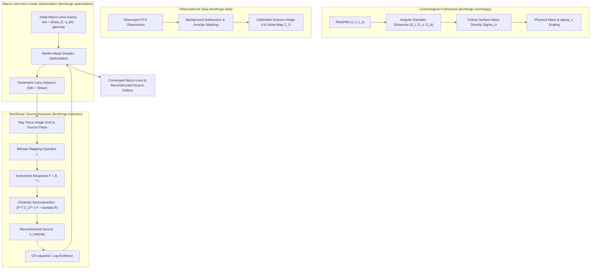

# LensForge Architecture & System Design

## 1. Architectural Philosophy

LensForge is designed as a modular, scientific research framework for gravitational lensing and galaxy reconstruction. The primary software engineering objectives are:

1. **Rigorous Separation of Concerns**: Mathematical physics is completely decoupled from rendering/visualization, instrumentation, and data I/O.
2. **Deterministic & Vectorized Numerical Core**: Core physical routines rely exclusively on NumPy and SciPy array operations, supporting both scalar evaluations and vectorized 2D grids without memory bloat.
3. **Explicit Error Policies**: Singularities (e.g., central ray divergence at $r=0$) and unphysical boundaries ($M \le 0$, $D_s \le D_l$) are trapped explicitly rather than silently propagating `NaN`s.
4. **Semilinear Decoupling**: Solves the inverse problem by decoupling the inner linear source inversion (solved analytically via Cholesky decomposition) from the outer non-linear macro-lens optimization (solved via Nelder-Mead simplex search).
5. **Local Workstation & CLI Portability**: Zero hardcoded local file paths, zero non-standard GUI dependencies, native cross-platform support (Windows/Linux/macOS), and simple editable installation (`pip install -e .`).

---

## 2. Repository Layout & Package Organization

```
lensforge/
├── README.md                          # High-level overview, quickstart, local workflow
├── PRD.md                             # Product Requirements Document
├── pyproject.toml                     # Modern PEP 518/621 build specification
├── .gitignore                         # Scientific Python / Jupyter / IDE gitignore
├── .github/
│   └── workflows/
│       └── ci.yml                     # GitHub Actions CI matrix (Linux, macOS, Windows)
├── paper/
│   ├── paper.md                       # JOSS submission paper draft
│   └── paper.bib                      # BibTeX citations for astrophysics literature
├── configs/
│   └── lens/
│       ├── point_mass.yaml            # Parameter configuration file for point mass
│       └── galaxy_sie_shear.yaml      # Parameter configuration for realistic galaxy lens
├── docs/
│   ├── architecture.md                # System design & module boundaries (this file)
│   ├── mathematical_foundations.md    # Analytical derivations from general relativity
│   ├── numerical_conventions.md       # Units, coordinate systems, and singularity policies
│   └── development_roadmap.md         # Phased research & development milestones
├── src/
│   └── lensforge/
│       ├── __init__.py                # Package exports and version metadata (v0.4.0)
│       ├── constants.py               # CODATA physical constants & angular conversions
│       ├── cli.py                     # CLI entrypoints (lensforge-reconstruct)
│       ├── cosmology/
│       │   ├── __init__.py
│       │   └── distances.py           # FLRW cosmological distance & Sigma_cr engine
│       ├── data/
│       │   ├── __init__.py
│       │   └── fits_pipeline.py       # FITS I/O, sigma-clipping sky, annular masking
│       ├── optimization/
│       │   ├── __init__.py
│       │   └── lens_optimizer.py      # Macro-lens non-linear fitting & semilinear MAP
│       ├── physics/
│       │   ├── __init__.py            # Physics API entry point
│       │   ├── coordinates.py         # 2D angular coordinates, CoordinateGrid dataclass
│       │   ├── distances.py           # Angular-diameter distances & Einstein radius
│       │   ├── lens_equation.py       # Thin-screen ray-tracing mapping
│       │   ├── lens_potential.py      # Effective lensing potential & finite diff gradient
│       │   ├── magnification.py       # Jacobian, signed/absolute magnification, parity
│       │   └── models/
│       │       ├── __init__.py        # Models package exports
│       │       ├── base.py            # BaseLensModel abstract base class
│       │       ├── point_mass.py      # Schwarzschild point-mass model
│       │       ├── sis.py             # Singular Isothermal Sphere model
│       │       ├── sie.py             # Singular Isothermal Ellipsoid model (KSB94)
│       │       ├── shear.py           # External gravitational tidal shear
│       │       └── composite.py       # Composite multi-component lens model
│       ├── instrument/
│       │   ├── __init__.py
│       │   ├── psf.py                 # Gaussian & Pixelated PSF convolution
│       │   └── noise.py               # Poisson photon shot noise & Gaussian read noise
│       ├── inversion/
│       │   ├── __init__.py
│       │   ├── mapping.py             # Sparse bilinear deflection mapping matrix L
│       │   ├── regularization.py      # Laplacian curvature & gradient prior matrices R
│       │   ├── reconstructor.py       # Semilinear regularized inversion engine
│       │   └── pipeline.py            # Automated galaxy reconstruction workflow
│       ├── imaging/
│       │   ├── __init__.py            # Imaging API entry point
│       │   └── source_models.py       # Background galaxy profiles & ray-traced sampling
│       └── visualization/
│           ├── __init__.py            # Visualization API entry point
│           └── lens_plots.py          # Publication-quality scientific figures
├── tests/
│   ├── test_coordinates.py            # Unit conversion & coordinate grid tests
│   ├── test_cosmology.py              # FLRW distance, Astropy comparison, Sigma_cr tests
│   ├── test_fits_pipeline.py          # FITS I/O, sky background, annular mask tests
│   ├── test_image_positions.py        # Analytical image solver & algebraic invariants
│   ├── test_instrument.py             # PSF convolution & detector noise tests
│   ├── test_inversion.py              # Mapping, regularization & Cholesky MAP tests
│   ├── test_lens_optimizer.py         # Semilinear macro-lens convergence tests
│   ├── test_magnification.py          # Parity, asymptotics, stability, caustic checks
│   ├── test_point_mass_lens.py        # Deflection, potential gradient, distance validation
│   ├── test_shear_and_composite.py    # External shear & CompositeLens superposition tests
│   ├── test_sie_lens.py               # SIE deflection, potential gradient, spherical limit
│   └── test_sis_lens.py               # SIS deflection, potential, image invariants
├── scripts/
│   ├── benchmark_slacs_reconstruction.py  # SLACS SDSS J0946+1006 benchmark case study
│   ├── reconstruct_galaxy.py              # Bayesian galaxy source reconstruction
│   ├── demonstrate_galaxy_lens.py         # Realistic galaxy SIE+shear arc demonstration
│   └── demonstrate_point_mass_lens.py     # Point-mass forward simulation demonstration
└── notebooks/
    └── README.md                      # Local interactive research notebook instructions
```

---

## 3. Subsystem Interplay & Data Flow

The full forward and semilinear inverse data flow proceeds as follows:



---

## 4. Architectural Boundaries

- **Physics Purity**: `lensforge.physics` contains zero plotting code and zero FITS I/O.
- **Instrument Modeling**: `lensforge.instrument` encapsulates optical point spread function convolution and astronomical noise simulation without depending on specific lens profiles.
- **Linear Inversion**: `lensforge.inversion` defines abstract linear operators ($\mathbf{L}, \mathbf{B}, \mathbf{R}$) independent of the specific mass profile implementation.
- **Macro-Lens Fitting**: `lensforge.optimization` handles non-linear parameter estimation without hard-coding specific telescope parameters.
- **Standardized Data Objects**: `AstroObservation`, `CoordinateGrid`, `ReconstructionResult`, and `MacroLensFitResult` provide clean, dataclass-based interfaces across the entire pipeline.
