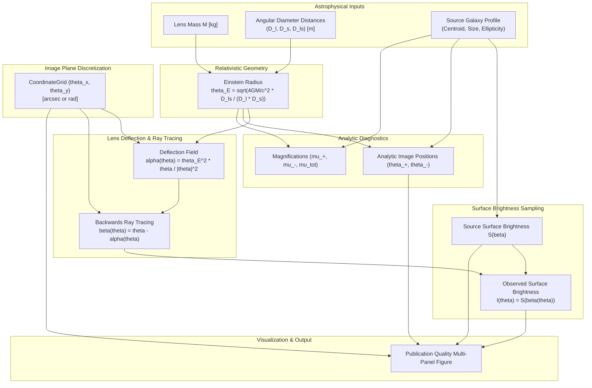

# LensForge Architecture & System Design

## 1. Architectural Philosophy

LensForge is designed as a modular, scientific research framework for gravitational lensing and galaxy reconstruction. The primary software engineering objectives are:

1. **Rigorous Separation of Concerns**: Mathematical physics is completely decoupled from rendering/visualization and data I/O.
2. **Deterministic & Vectorized Numerical Core**: Core physical routines rely exclusively on NumPy and SciPy array operations, supporting both scalar evaluations and vectorized 2D grids without memory bloat.
3. **Explicit Error Policies**: Singularities (e.g., central ray divergence at $r=0$) and unphysical boundaries ($M \le 0$, $D_s \le D_l$) are trapped explicitly rather than silently propagating `NaN`s.
4. **Colab & Headless Portability**: Zero hardcoded local file paths, zero non-standard GUI dependencies, and simple editable installation (`pip install -e .`).

---

## 2. Repository Layout & Package Organization

```
lensforge/
├── README.md                          # High-level overview, quickstart, Colab instructions
├── PRD.md                             # Product Requirements Document
├── pyproject.toml                     # Modern PEP 518/621 build specification
├── .gitignore                         # Scientific Python / Jupyter / IDE gitignore
├── configs/
│   └── lens/
│       ├── point_mass.yaml            # Parameter configuration file for point mass
│       └── galaxy_sie_shear.yaml      # Parameter configuration for realistic galaxy lens
├── docs/
│   ├── architecture.md                # System design & module boundaries (this file)
│   ├── mathematical_foundations.md    # Analytical derivations from general relativity
│   ├── numerical_conventions.md       # Units, coordinate systems, and singularity policies
│   └── development_roadmap.md         # Phased research & development milestones
├── src/
│   └── lensforge/
│       ├── __init__.py                # Package exports and version metadata
│       ├── constants.py               # CODATA physical constants & angular conversions
│       ├── physics/
│       │   ├── __init__.py            # Physics API entry point
│       │   ├── coordinates.py         # 2D angular coordinates, CoordinateGrid dataclass
│       │   ├── distances.py           # Angular-diameter distances & Einstein radius (point-mass & SIS)
│       │   ├── lens_equation.py       # Thin-screen ray-tracing mapping
│       │   ├── lens_potential.py      # Effective lensing potential & finite diff gradient
│       │   ├── magnification.py       # Jacobian, signed/absolute magnification, parity
│       │   └── models/
│       │       ├── __init__.py        # Models package exports
│       │       ├── base.py            # BaseLensModel abstract base class
│       │       ├── point_mass.py      # Schwarzschild point-mass model
│       │       ├── sis.py             # Singular Isothermal Sphere model
│       │       ├── sie.py             # Singular Isothermal Ellipsoid model (KSB94)
│       │       ├── shear.py           # External gravitational tidal shear
│       │       └── composite.py       # Composite multi-component lens model
│       ├── imaging/
│       │   ├── __init__.py            # Imaging API entry point
│       │   └── source_models.py       # Background galaxy profiles & ray-traced sampling
│       └── visualization/
│           ├── __init__.py            # Visualization API entry point
│           └── lens_plots.py          # Publication-quality scientific figures
├── tests/
│   ├── test_coordinates.py            # Unit conversion & coordinate grid tests
│   ├── test_point_mass_lens.py        # Deflection, potential gradient, distance validation
│   ├── test_image_positions.py        # Analytical image solver & algebraic invariants
│   ├── test_magnification.py          # Parity, asymptotics, stability, caustic divergence
│   ├── test_sis_lens.py               # SIS deflection, potential, image invariants, velocity dispersion
│   ├── test_sie_lens.py               # SIE deflection, potential gradient, spherical limit, convergence
│   └── test_shear_and_composite.py    # External shear & CompositeLens superposition tests
├── scripts/
│   ├── demonstrate_point_mass_lens.py # Point-mass forward simulation demonstration
│   └── demonstrate_galaxy_lens.py     # Realistic galaxy SIE+shear arc demonstration
└── notebooks/
    └── README.md                      # Google Colab execution instructions & Drive workflow
```

---

## 3. Data Flow Architecture

The forward modeling pipeline proceeds along a strictly unidirectional data flow:



---

## 4. Architectural Boundaries and Component Responsibilities

### `lensforge.constants`
- **Responsibility**: Scientific single source of truth for fundamental physical constants in SI units (CODATA values for $c$, $G$, $M_{\odot}$, astronomical distance conversions) and high-precision angular conversions.
- **Rule**: Pure numerical constants and algebraic functions. Zero internal dependencies.

### `lensforge.physics.coordinates`
- **Responsibility**: Representation and generation of 2D angular sky coordinates, meshgrids, pixel sizes, and spatial bounding boxes (`CoordinateGrid`).
- **Rule**: Validates shape compatibility and enforces strict separation between radians, arcseconds, and pixel indices.

### `lensforge.physics.distances`
- **Responsibility**: Computes angular-diameter distances and the relativistic Einstein angular radius $\theta_E$.
- **Rule**: Validates physical boundary conditions ($M > 0$, $D_l > 0$, $D_s > 0$, $D_{ls} > 0$, and cosmological causal ordering $D_s > D_l$).

### `lensforge.physics.lens_equation`
- **Responsibility**: Evaluates the thin-screen gravitational lens equation $\boldsymbol{\beta} = \boldsymbol{\theta} - \boldsymbol{\alpha}(\boldsymbol{\theta})$ for backwards ray-tracing.
- **Rule**: Operates purely on broadcast NumPy arrays.

### `lensforge.physics.lens_potential`
- **Responsibility**: Evaluates effective projected gravitational potential $\psi(\boldsymbol{\theta})$ and numerical derivatives via finite differences.
- **Rule**: Houses explicit `SingularityError` to prevent unhandled zero-division.

### `lensforge.physics.magnification`
- **Responsibility**: Calculates signed, absolute, and unresolved total magnifications.
- **Rule**: Employs rationalized algebraic expressions to completely eliminate catastrophic floating-point cancellation for large impact parameters ($u \gg 1$), ensuring strict topological parity preservation.

### `lensforge.physics.models.point_mass`
- **Responsibility**: High-level parametric class `PointMassLens` orchestrating deflection, potential, analytical image positions, and caustic detection.
- **Rule**: Completely agnostic to camera pixelation, PSFs, and plotting frameworks.

### `lensforge.imaging.source_models`
- **Responsibility**: Continuous surface brightness distributions $S(\boldsymbol{\beta})$ of unlensed galaxies (e.g. `GaussianSource`), and ray-traced image-plane sampling via Liouville's theorem.
- **Rule**: Decoupled from lens physics; only accepts source-plane coordinates $(\beta_x, \beta_y)$.

### `lensforge.visualization.lens_plots`
- **Responsibility**: Renders Matplotlib scientific figures with clear axis labels, physical units, critical curves (Einstein ring), and analytical markers.
- **Rule**: Does not perform physics calculations; consumes precomputed arrays and dataclasses.

---

## 5. Design for Future Phases

The architecture is explicitly constructed to support modular extension without breaking existing APIs:

- **Phase 2 (Extended Mass Profiles)**: New classes `SingularIsothermalSphere` and `SingularIsothermalEllipsoid` will implement the standard interface (`deflection`, `potential`, `ray_trace`).
- **Phase 3 (Telescope Forward Model)**: A new `lensforge.instrument` module will introduce convolution kernels $\mathcal{P} * I$ (FFT-based PSF) and noise generators $\mathcal{N}$ (Gaussian readout noise and Poisson shot noise).
- **Phase 4 (Source Inversion Engine)**: A new `lensforge.inversion` module will implement pixelated source reconstruction matrices $\mathbf{F} = \mathbf{B} \mathbf{L}$ with regularizing covariance operators (gradient and curvature priors) following the Warren & Dye (2003) and Treu (2010) frameworks.
