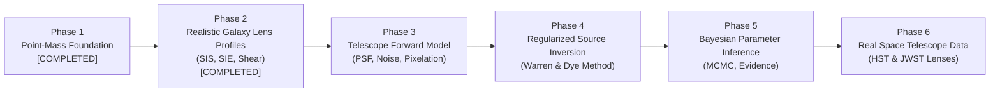

# LensForge Development Roadmap

This document outlines the phased research and engineering progression for LensForge, moving from the mathematical foundations of point-mass lensing to full Bayesian galaxy source reconstruction from real space telescope observations.

---

## Roadmap Overview

---

## Detailed Milestone Descriptions

### Phase 1: Point-Mass Mathematical Foundation & Repository Scaffold
- **Status**: Completed ✅
- **Deliverables**:
  - Full scientific repository structure with `src/` layout and `pyproject.toml`.
  - SI physical constants and bidirectional angular conversion utilities.
  - Relativistic Einstein radius computation with cosmological distance validation.
  - Point-mass deflection field $\boldsymbol{\alpha}(\boldsymbol{\theta})$ and potential $\psi(\boldsymbol{\theta})$.
  - Verified numerical gradient equivalence: $\nabla \psi = \boldsymbol{\alpha}$.
  - Analytical point-image solver ($\theta_+, \theta_-$) and algebraic invariant verification.
  - Signed and absolute magnifications with rationalized numerical cancellation prevention.
  - Ideal backward ray-tracing and 2D Gaussian galaxy simulation.
  - 100% deterministic test coverage across all mathematical foundations.

---

### Phase 2: Realistic Galaxy Lens Profiles (SIS & SIE, External Shear)
- **Status**: Completed ✅
- **Deliverables**:
  - `BaseLensModel` abstract interface with unified Jacobian, magnification, convergence, and shear routines.
  - **Singular Isothermal Sphere (SIS)**:
    - Deflection $\boldsymbol{\alpha}(\boldsymbol{\theta}) = \theta_E \frac{\boldsymbol{\theta}}{|\boldsymbol{\theta}|}$, potential $\psi(\boldsymbol{\theta}) = \theta_E |\boldsymbol{\theta}|$.
    - Velocity dispersion $\sigma_v$ scaling: $\theta_E = 4\pi (\frac{\sigma_v}{c})^2 \frac{D_{ls}}{D_s}$.
    - Analytical image roots ($\theta_+, \theta_-$), constant separation $\theta_+ - \theta_- = 2\theta_E$, magnification invariant $\mu_+ + \mu_- = 2.0$.
  - **Singular Isothermal Ellipsoid (SIE)**:
    - Kormann, Schneider & Bartelmann (1994) analytical complex deflection formulas.
    - Coordinate rotations for arbitrary position angles $\phi$.
    - Potential formulation via Euler's homogeneous function theorem: $\psi = \boldsymbol{\theta} \cdot \boldsymbol{\alpha}$.
    - Analytical convergence $\kappa(\boldsymbol{\theta})$ and smooth spherical limit matching SIS as $q \to 1$.
  - **External Gravitational Shear**:
    - Cartesian $(\gamma_1, \gamma_2)$ and polar $(\gamma, \phi_\gamma)$ tidal formulations.
    - Zero convergence ($\kappa = 0$) and constant magnification $\mu = 1 / (1 - \gamma^2)$.
  - **Composite Lens Superposition**:
    - `CompositeLens` superposing mass components and tidal shear.
  - End-to-end forward demonstration (`scripts/demonstrate_galaxy_lens.py`) producing giant arcs and quad/double image morphologies.
  - Complete 44-test automated test suite passing in $< 0.5$ seconds.

---

### Phase 3: Realistic Telescope Observation Model
- **Target**: Next Immediate Milestone
- **Forward Model Formulation**:
  $$\mathcal{D} = \mathcal{P} * \mathcal{L}_{\eta}(\mathcal{S}) + \mathcal{N}$$
- **Components**:
  - `lensforge.instrument.psf`:
    - 2D Gaussian, Airy disc, and empirical FITS pixelated telescope PSFs.
    - Fast 2D FFT-based convolution with anti-aliasing.
  - `lensforge.instrument.noise`:
    - Gaussian read noise ($\sigma_{\text{read}}$).
    - Poissonian photon shot noise from galaxy and sky background.
  - Sub-pixel supersampling and sensor pixel integration.

---

### Phase 4: Regularized Galaxy Source Inversion
- **Objective**: Reconstruct the unlensed galaxy surface brightness $\mathcal{S}$ without assuming a rigid parametric profile (e.g. Gaussian or Sérsic).
- **Mathematical Framework**:
  - Linear discretization on Delaunay tessellation or adaptive Cartesian mesh.
  - Response operator $\mathbf{f} = \mathbf{B} \mathbf{L} \mathbf{s} + \mathbf{n}$, where $\mathbf{B}$ is PSF blurring and $\mathbf{L}$ is lens deflection mapping.
  - Regularized quadratic objective:
    $$\mathcal{E}(\mathbf{s}) = \frac{1}{2} (\mathbf{d} - \mathbf{F} \mathbf{s})^T \mathbf{C}_D^{-1} (\mathbf{d} - \mathbf{F} \mathbf{s}) + \lambda \mathbf{s}^T \mathbf{R} \mathbf{s}$$
  - Regularization operators $\mathbf{R}$: Zero-order gradient (norm), first-order gradient (smoothness), and second-order curvature (Laplacian).
  - Analytic maximum a posteriori solution:
    $$\hat{\mathbf{s}} = (\mathbf{F}^T \mathbf{C}_D^{-1} \mathbf{F} + \lambda \mathbf{R})^{-1} \mathbf{F}^T \mathbf{C}_D^{-1} \mathbf{d}$$

---

### Phase 5: Bayesian Inference & Lens Parameter Optimization
- **Simultaneous Parameter Optimization**:
  - Optimize macro-lens parameters $\boldsymbol{\eta} = (\theta_E, \boldsymbol{\theta}_l, q, \phi, \gamma)$ in an outer loop while analytically solving for the optimal source $\hat{\mathbf{s}}(\boldsymbol{\eta})$ in an inner loop.
- **Algorithms**:
  - Scipy nonlinear conjugate gradient / L-BFGS-B for maximum likelihood point estimation.
  - Markov Chain Monte Carlo (MCMC) ensemble sampling (e.g., Affine Invariant Sampler) for posterior credible intervals.
  - Bayesian Evidence evaluation for model selection.

---

### Phase 6: Space Telescope Data & Colab High-Performance Benchmarking
- **Observational Datasets**:
  - Ingestion of FITS data from Hubble Space Telescope (HST SLACS, CANDELS) and JWST (COSMOS-Web) strong lenses.
  - Astrometric alignment and background subtraction pipelines.
- **Execution Scaling**:
  - Google Colab GPU-accelerated ray-tracing (JAX/PyTorch drop-in backends).
  - Colab notebook tutorials reproducing published astrophysical reconstructions.
