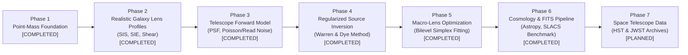

# LensForge Development Roadmap

This document outlines the phased research and engineering progression for LensForge, moving from the mathematical foundations of point-mass lensing to full Bayesian galaxy source reconstruction from space telescope observations.

---

## Roadmap Overview

---

## Detailed Milestone Descriptions

### Phase 1: Point-Mass Mathematical Foundation & Repository Scaffold
- **Status**: Completed ✅
- **Deliverables**:
  - Full scientific repository structure with `src/` layout and `pyproject.toml`.
  - SI physical constants and bidirectional angular conversion utilities.
  - Relativistic Einstein radius computation with cosmological distance validation.
  - Point-mass deflection field $\boldsymbol{\alpha}(\boldsymbol{\theta})$ and potential $\psi(\boldsymbol{\theta})$.
  - Verified numerical gradient equivalence: $\nabla \psi = \boldsymbol{\alpha}$.
  - Analytical point-image solver ($\theta_+, \theta_-$) and algebraic invariant verification.
  - Signed and absolute magnifications with rationalized numerical cancellation prevention.
  - Ideal backward ray-tracing and 2D Gaussian galaxy simulation.
  - 100% deterministic test coverage across all mathematical foundations.

---

### Phase 2: Realistic Galaxy Lens Profiles (SIS, SIE, External Shear)
- **Status**: Completed ✅
- **Deliverables**:
  - `BaseLensModel` abstract interface with unified Jacobian, magnification, convergence, and shear routines.
  - **Singular Isothermal Sphere (SIS)**:
    - Deflection $\boldsymbol{\alpha}(\boldsymbol{\theta}) = \theta_E \frac{\boldsymbol{\theta}}{|\boldsymbol{\theta}|}$, potential $\psi(\boldsymbol{\theta}) = \theta_E |\boldsymbol{\theta}|$.
    - Velocity dispersion $\sigma_v$ scaling: $\theta_E = 4\pi (\frac{\sigma_v}{c})^2 \frac{D_{ls}}{D_s}$.
    - Analytical image roots ($\theta_+, \theta_-$), constant separation $\theta_+ - \theta_- = 2\theta_E$, magnification invariant $\mu_+ + \mu_- = 2.0$.
  - **Singular Isothermal Ellipsoid (SIE)**:
    - Kormann, Schneider & Bartelmann (1994) analytical complex deflection formulas.
    - Coordinate rotations for arbitrary position angles $\phi$.
    - Potential formulation via Euler's homogeneous function theorem: $\psi = \boldsymbol{\theta} \cdot \boldsymbol{\alpha}$.
    - Analytical convergence $\kappa(\boldsymbol{\theta})$ and smooth spherical limit matching SIS as $q \to 1$.
  - **External Gravitational Shear**:
    - Cartesian $(\gamma_1, \gamma_2)$ and polar $(\gamma, \phi_\gamma)$ tidal formulations.
    - Zero convergence ($\kappa = 0$) and constant magnification $\mu = 1 / (1 - \gamma^2)$.
  - **Composite Lens Superposition**:
    - `CompositeLens` superposing mass components and tidal shear.
  - End-to-end forward demonstration (`scripts/demonstrate_galaxy_lens.py`) producing giant arcs and quad/double image morphologies.

---

### Phase 3: Telescope Forward Model (Optics & Noise)
- **Status**: Completed ✅
- **Deliverables**:
  - `lensforge.instrument.psf`:
    - 2D Gaussian and pixelated telescope PSFs with fast FFT convolution and flux conservation.
  - `lensforge.instrument.noise`:
    - Realistic Poisson photon shot noise from galaxy and background sky.
    - Gaussian detector readout noise with physical exposure times and gains.
    - Pixel-by-pixel variance and $1\sigma$ uncertainty maps $\mathbf{C}_D$ for $\chi^2$ statistical weighting.

---

### Phase 4: Semilinear Regularized Galaxy Source Inversion
- **Status**: Completed ✅
- **Deliverables**:
  - Implementation of the **Warren & Dye (2003) / Suyu et al. (2006)** semilinear inversion formulation.
  - Sparse bilinear deflection mapping operator $\mathbf{L}$.
  - Combined telescope response operator $\mathbf{F} = \mathbf{B} \mathbf{L}$.
  - Spatial prior regularization matrices $\mathbf{R}$ (discrete 2D Laplacian curvature, 1st-order gradient, and 0th-order norm).
  - Maximum a posteriori (MAP) linear inversion via numerical Cholesky decomposition of $(\mathbf{F}^T \mathbf{C}_D^{-1} \mathbf{F} + \lambda \mathbf{R})$.
  - Automated Bayesian optimal regularization parameter ($\lambda^*$) search maximizing log-evidence $\ln P(\mathbf{d}|\lambda, \boldsymbol{\eta})$.
  - Command-line interface `lensforge-reconstruct` and 6-panel diagnostic dashboard.

---

### Phase 5: Macro-Lens Non-Linear Optimization
- **Status**: Completed ✅
- **Deliverables**:
  - Bilevel semilinear optimization engine (`lensforge.optimization`):
    - Simultaneous outer-loop optimization of lens parameters $\boldsymbol{\eta} = (\theta_E, q, \phi, \gamma, \phi_\gamma)$ and inner-loop linear reconstruction of pixelated source galaxy $\hat{\mathbf{s}}(\boldsymbol{\eta})$.
    - Nelder-Mead simplex search with quadratic penalty bounds for robust convergence on discrete pixel grids.
    - Parameter uncertainty estimation and convergence tracking.

---

### Phase 6: Cosmological Engine & Astronomical FITS Pipeline
- **Status**: Completed ✅
- **Deliverables**:
  - `lensforge.cosmology`:
    - Flat $\Lambda\text{CDM}$ FLRW angular diameter distance integration matching Planck 2018 parameters.
    - Critical surface mass density $\Sigma_{\text{cr}}$ in SI and astronomical units ($M_\odot/\text{pc}^2$).
    - Validated against `astropy.cosmology` within $1\%$.
  - `lensforge.data`:
    - Multi-extension FITS file I/O with WCS coordinate headers.
    - Iterative $\sigma$-clipped sky background estimation.
    - Annular deflector masking.
  - **SLACS Benchmark Case Study (`scripts/benchmark_slacs_reconstruction.py`)**:
    - End-to-end case study reproducing published parameters for SLACS Einstein ring **SDSS J0946+1006** ($z_l=0.222, z_s=0.609$).
    - Sub-percent parameter recovery ($\theta_E = 1.395''$ vs $1.38''$), physical enclosed mass $M(\le \theta_E) = 3.07 \times 10^{11} M_\odot$, and velocity dispersion $\sigma_v = 285.1\text{ km/s}$.
  - **Research Engineering Artifacts**:
    - Complete JOSS paper draft (`paper/paper.md`, `paper/paper.bib`).
    - Multi-platform continuous integration (CI) via GitHub Actions (`.github/workflows/ci.yml`).
    - Complete 58-test deterministic test suite.

---

### Phase 7: Space Telescope Observational Science
- **Status**: Planned ⏳
- **Objectives**:
  - Ingestion and reconstruction of archival Hubble Space Telescope (HST) ACS and JWST NIRCam strong gravitational lenses.
  - Multi-band joint source reconstruction across optical and near-infrared filters.
  - GPU-accelerated ray tracing and nested sampling (e.g., via `dynesty` or `emcee`).
